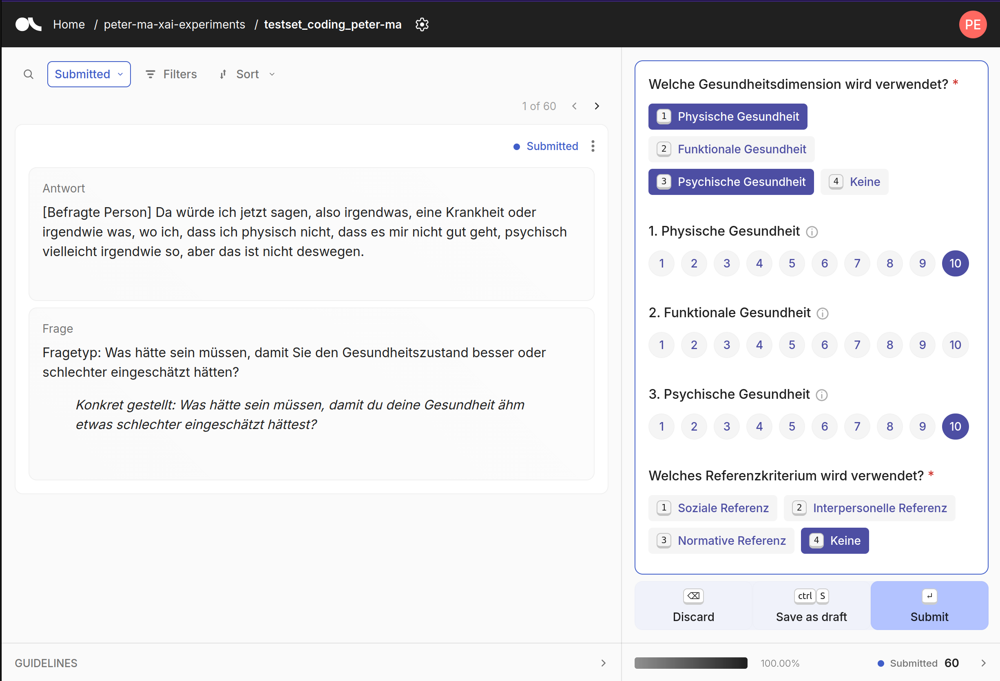
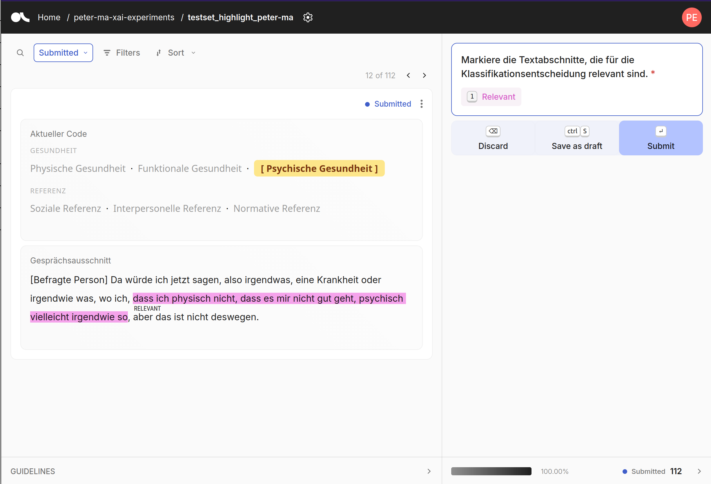
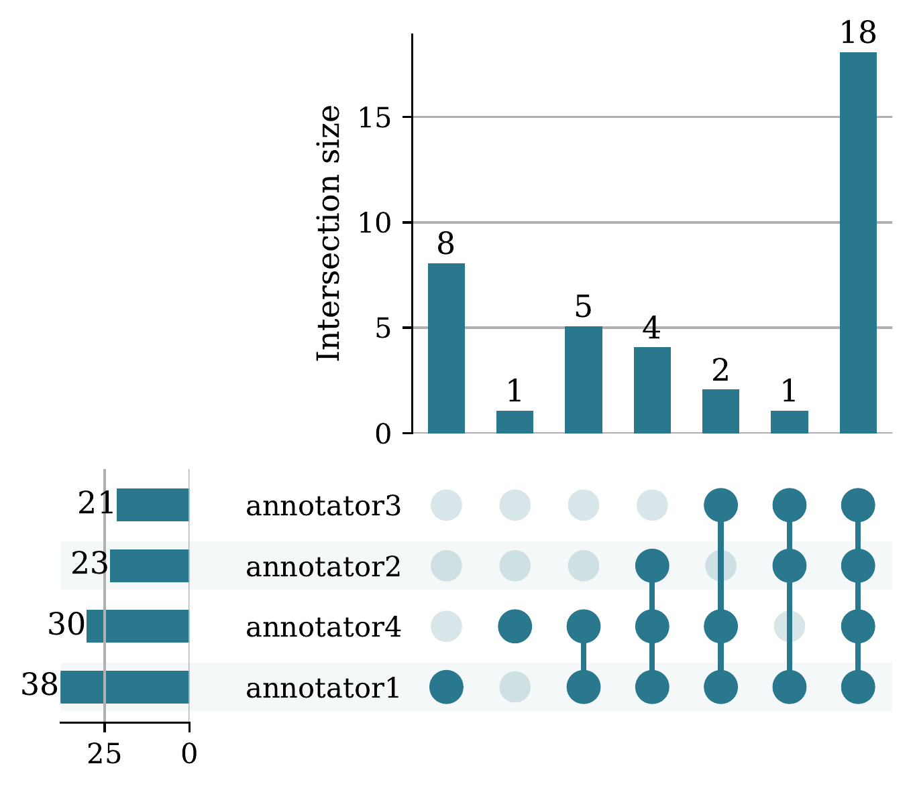
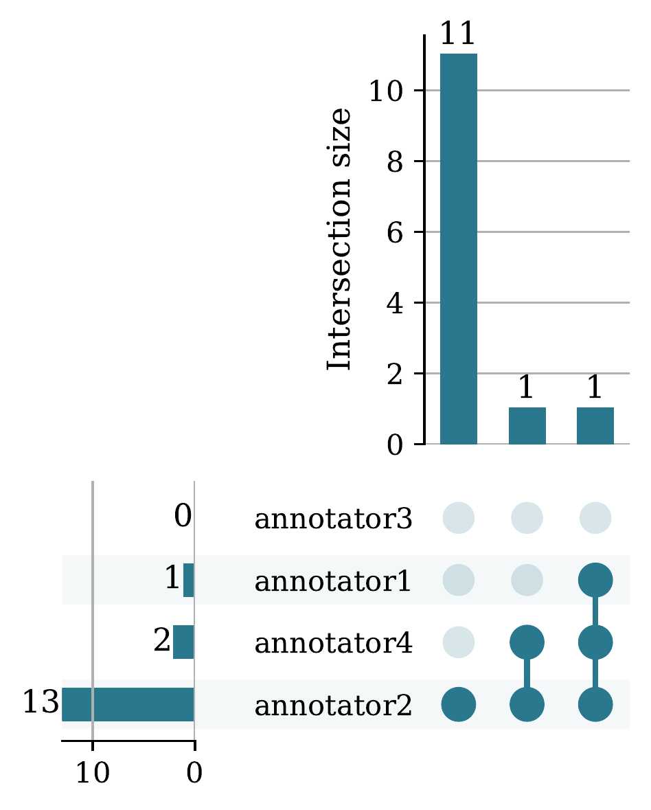
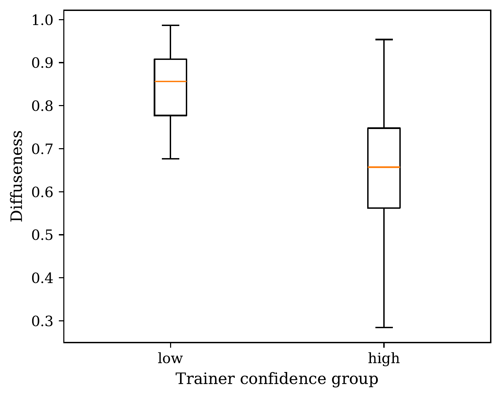

## Context of the XAI Experiments

One goal of our research project is to develop a coding tool that helps researchers scale up the labor-intensive task of coding. We approach this with active learning, a machine learning paradigm that iteratively involves human coders in model training: they decide on the boundary cases that are most informative for the model, so that it learns the human definition of the codes as efficiently as possible. After each feedback round, the model is retrained on the newly coded examples and, based on what it has learned so far, selects the next most informative examples from the pool of uncoded material (see our [article on active learning setups](/articles/active_learning_experiments/)). This process rests on a crucial assumption: that the human coder holds a coherent understanding of a code that someone else, be it another coder or a model, can adopt. Since this assumption also determines what "scaling up coding" can accomplish, we took the time to investigate, in an experiment with multiple coders, how the coders' understandings of the codes relate to each other and to the representation a model learns from them. To make this comparison, we used explainable AI (XAI) methods to identify the parts of an interview passage that are relevant to the model's prediction. This article briefly summarizes our findings.

The experiments are part of the author's master's thesis, which develops the methodological groundwork for this comparison: it examines how the representation a model learns from coded examples can be related to human interpretations of a code, and how XAI can be used to surface ambiguity in coding rather than conceal it. Here, we report only the observations most relevant to our work at AI-SIC; a more detailed publication will follow.

## Experimental Setup

To compare the model with the human coders, we needed to make their understanding of a code empirically comparable. We did this by tracing it back to the coded interview passages, highlighting the words that were important for a coding decision. Such highlights can be obtained from the human coders as well as, by means of XAI, from the classification model, and since both refer to the same passages, they can be compared directly. Although highlights are only an abstract proxy for the understanding of a code, our qualitative readings showed that in many cases they supported a coherent reading of it.

Our experiments draw on the first batch of 54 fully [transcribed and anonymized](/articles/transcription_insights/) cognitive interviews. As this was a preliminary study rather than our full coding, we restricted the analysis to selected questions from our interview guideline and to a limited set of codes: the health dimensions ("physical", "functional", "mental") and the reference criteria ("social", "intrapersonal", "normative") [@Kroh2023]. We located the relevant questions in the transcripts using a simple approach based on regular expressions.

After preprocessing, this left us with 281 respondent answers, which we split into a training set (221) and a test set (60). The training set was coded exclusively by the author of this article, who is referred to as the *trainer* in the following (annotator 1 in the figures), and served to train the classification model. The test set was coded by four project members, again including the author. In a first coding phase, each of them assigned one or more codes to every example and rated how certain they were of each assignment on a scale from 1 (very uncertain) to 10 (very certain) (see @fig-coding).

In a second phase, each coder was shown their own coding decisions again and asked to highlight the parts of the passage that had been relevant to each assignment (see @fig-highlighting).

::: {.figure .framed}
{#fig-coding width=100% fig-align="center"}
:::

::: {.figure .framed}
{#fig-highlighting width=100% fig-align="center"}
:::

The human coding alone already tells us a lot about how the coders understand the codes: we can derive agreement scores for individual codes, relate them to the coders' certainty ratings, and trace disagreements back to possibly divergent readings. To obtain comparable evidence on the model side, we used the XAI method Integrated Gradients [@Sundararajan2017]. It assigns each word of a passage an attribution score that indicates whether, and how strongly, the word pushed the model towards or away from a code.[^model] For every test example, this gives us the model's prediction, its probability for each code, and word-level attributions, the latter even for codes where the model's probability stayed below the 0.5 threshold.

[^model]: After pre-testing two models on passages with and without the interviewer's questions, we chose a fine-tuned [mpnet sentence transformer](https://huggingface.co/sentence-transformers/paraphrase-multilingual-mpnet-base-v2), which performed best overall.

## Findings

### The Human Side

Since the highlights were tied to the coding decisions, agreement among the coders on a code was a prerequisite for comparing them. In this respect, the experiments also turned out to be an insightful pre-test for our actual coding, as they showed that we did not interpret all codes uniformly.[^codebook] As @tbl-agreement shows, agreement varies considerably between the codes: it is highest for "Physical Health" and "Social Reference", the latter, however, being rarely assigned, and lowest for "Intrapersonal Reference" and "Normative Reference". As the reference criteria were assigned rarely or with low agreement, the model-side analysis focuses on the three health codes.

[^codebook]: The codes were defined in a detailed codebook at the time. In a debriefing after the coding, the team concluded that some of the disagreements could be traced back to ambiguous statements in the codebook, and that the lack of a proper briefing beforehand may have contributed to the variation in interpretation.

| Code | Assignments (of 240) | Krippendorff's α |
|---|---|---|
| Physical Health | 167 | 0.73 |
| Mental Health | 112 | 0.62 |
| Functional Health | 69 | 0.56 |
| Intrapersonal Reference | 64 | 0.25 |
| Social Reference | 23 | 0.73 |
| Normative Reference | 16 | 0.11 |

: Intercoder reliability by code. Assignments count how often a code was assigned across the 60 test passages and four coders (at most 240). {#tbl-agreement}

One reason for these mixed results lies in single coders whose understanding of a code deviated from that of the others: this happened for three codes, each time with a different coder. The UpSet plot in @fig-upset-mental shows this for "Mental Health": annotator 1, the trainer, assigned the code to 8 passages where none of the other coders did. In these cases, the trainer counted rather general descriptions of health as mental health, since the codebook contained an ambiguous example for such cases. An average certainty of 3.375 for these assignments indicates that the trainer was unsure about them as well. Similar patterns can be observed for "Intrapersonal Reference" and "Normative Reference". The latter was almost exclusively assigned by one coder: in 11 of the 13 cases in which this coder assigned it, no one else did (@fig-upset-normative). This time, however, the coder was confident in the divergent reading, with an average certainty of 8.23.

::: {#fig-upset .framed layout="[[59.6,40.4]]" layout-valign="bottom"}
{#fig-upset-mental}

{#fig-upset-normative}

Coder agreement on "Mental Health" and "Normative Reference". Each bar counts the passages to which exactly the combination of coders marked by the dots below assigned the code; the bars on the left show how often each coder assigned it in total.
:::

This leads to our first lesson: coding is a cognitively demanding task that involves at least two layers: understanding what a code means, and deciding whether a passage meets it. Vague formulations in the codebook can create uncertainty in the latter and, as a consequence, disagreement between coders. But even when coders are certain in their decisions, their understandings of what a code means may still differ.

### The Model Side

On the model side, we wanted to know how the coders' divergent interpretations relate to the representation the model learns from the coded examples. As the model was trained on examples coded by the trainer alone, the first question was how far this shapes its representation compared to the other coders. Put simply: is the model a puppet of its trainer, or can it infer a more general representation of a code from the training examples? Our experiments point towards the former. When we ranked the coders by how closely their highlights matched the model's positive attributions, the trainer ranked closest to the model on average for each of the three health codes.[^ranking]

[^ranking]: We only considered passages to which the trainer and at least one other coder had assigned the same code. Highlights and positive attributions were compared using a size-corrected Dice score; the resulting ranks were normalized by the number of coders in each comparison and compared against the rank expected under random ordering.

@fig-motivation shows a case in which this lean becomes visible. All four coders assigned "Mental Health" to the passage, but while the other coders highlighted only "seelisches Wohlbefinden" (mental well-being) as relevant, the trainer additionally highlighted "Motivation mich zu bewegen" (motivation to get moving). The model assigns its highest attribution score to the word "Motivation", which indicates that its representation is closer to the trainer's reading in this case.

::: {#fig-motivation}
::: {style="border: 1px solid #333; border-radius: 3px; padding: 0.8em 1em; font-size: 0.9em; text-align: left;"}
**Other coders (annotators 2–4):** Ähm also mein eigenes einfach allgemein körperliches Wohlbefinden [seelisches Wohlbefinden]{style="background-color: #FFD166;"} ähm meine Aktivität ähm Aktivitätsgrad Motivation mich zu bewegen ähm gehört auch Ernährung dazu ähm Appetit ähm Dann Krankheitsausfälle, klar, […]

**Trainer (annotator 1):** Ähm also mein eigenes einfach allgemein körperliches Wohlbefinden [seelisches Wohlbefinden]{style="background-color: #9BBCFF;"} ähm meine Aktivität ähm Aktivitätsgrad [Motivation mich zu bewegen]{style="background-color: #9BBCFF;"} ähm gehört auch Ernährung dazu ähm Appetit ähm Dann Krankheitsausfälle, klar, […]

**Model attributions:** Ähm also mein eigenes einfach allgemein [körperliches]{style="background-color: rgba(230, 0, 0, 0.55);"} [Wohlbefinden]{style="background-color: rgba(0, 200, 0, 0.14);"} [seelisches]{style="background-color: rgba(0, 200, 0, 0.30);"} [Wohlbefinden]{style="background-color: rgba(0, 200, 0, 0.10);"} ähm meine Aktivität ähm Aktivitätsgrad [Motivation]{style="background-color: rgba(0, 200, 0, 0.42);"} mich zu bewegen ähm gehört auch Ernährung dazu ähm Appetit ähm Dann Krankheitsausfälle, klar, […]

*Top-scoring words:* Motivation (+1.85) · seelisches (+1.34) · Wohlbefinden (+0.64) · Wohlbefinden (+0.46) · ähm (+0.11)
:::

Highlights and model attributions for a passage coded as "Mental Health" by all four coders. The model attributions use green for positive and red for negative values, shaded relative to the strongest attribution.
:::

Another finding that shows in this example is the importance of key terms that trigger a code assignment. The positive attributions are distributed very unevenly: "Motivation" receives a score of +1.85, about three times as much as the third-highest word. "Seelisches" also scores high, and it is arguably the term that carries the consistent assignment of the code across all coders and the model in this case. Across codes, this concentration is most pronounced for "Physical Health", where the highest-scoring word alone accounts for 41% of a passage's positive attribution on average. The same code also showed the highest agreement among the coders and the closest match between human highlights and model attributions. In contrast, where the trainer was uncertain about an assignment, the model's attributions were spread more evenly across the passage (@fig-entropy).[^entropy]

[^entropy]: We measured this spread ("diffuseness" in @fig-entropy) as the entropy of the positive attributions, normalized by the number of positively attributed words. Assignments with low trainer certainty (below 8, n = 41) reached a mean entropy of 0.83 ± 0.11, those with high certainty (above 8, n = 35) a mean of 0.65 ± 0.14.

::: {.figure .framed}
{#fig-entropy width=60% fig-align="center"}
:::

These general trends were complemented by a close reading, which showed that, read across multiple examples, the attributions could in some cases be assembled into a coherent reading of the model's representation of a code. For instance, terms related to everyday activities, such as playing, doing sports and going to school, received high attribution scores for "Functional Health" across several examples. However, this is a selective reading that may not hold for other cases. The attributions were also not always interpretable: in some cases, relatively high scores could not be brought into any coherent reading.

This leads to our second lesson, which can be summarized in three points:

- Model predictions always have to be considered in light of the interpretation carried by the training examples.
- Uncertainty in interpretation and ambiguity in the data are also reflected in the model's representation of a code.
- To some extent, IG attributions can make this representation accessible.

## What Does This Mean for the AI-SIC Project?

In our use case, the coding of cognitive interviews, we aim to minimize ambiguity, as our codes serve to ground statements about empirical relationships in the data. Nonetheless, some ambiguity is unavoidable when applying abstract codes to diverse interview material, since this is always an interpretive act. As a consequence of the experiments, we revised our codebook and now brief our coders in order to reduce the room for interpretation wherever possible. In this setting, XAI attributions can serve as an intermediate quality check after several rounds of training, verifying that the model has picked up the right cues before it is applied to unseen material.

In other forms of social science coding, such as Grounded Theory, ambiguity is embraced as a productive part of the coding itself. Here, XAI attributions could be used in a more interactive human–machine setting to surface the ambiguity in the learned representation, for example by deliberately reviewing cases with diffuse attributions or by reading attributions across assignments. Confronting this ambiguity could then push researchers to rethink their own categories.

In both cases, however, our experiments show that attributions can be misleading when used as a decision aid [@Miller2023], as they themselves carry various kinds of ambiguity and are error-prone when read for a single case. Their intended use is therefore not to justify individual model decisions, for instance as a coding helper that tells coders why a code applies, but to support extended reasoning about the codebook and the modeling process across many cases.
