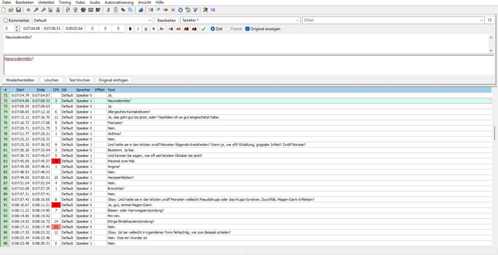
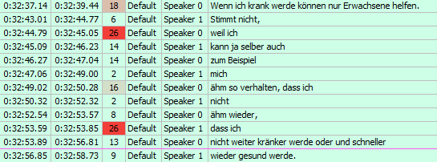
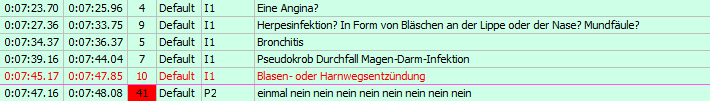
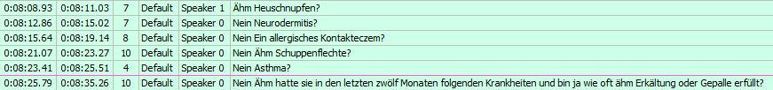

## Why this matters

Qualitative interviews are a rich data source, but turning audio into analyzable text is time-consuming and labor-intensive. Automatic speech recognition (ASR) models promise to automate this step. Yet many tools exist, and many challenges remain, especially for sensitive data and non-standard speech (see our [article on ASR evaluation](/articles/esra_transcription_evaluation/)). In the project AI-SIC, we develop an efficient framework to transcribe and code qualitative data using different machine learning methods. This post reports on another output of the project: our experience transcribing qualitative interviews with AI and correcting the results by hand.

## The data

We worked with 96 German-language interviews on children's health stemming from cognitive interviews with both children (aged 8–16) and their parents. Parents were asked about their overall assessment of their children's health, medical diagnoses and illnesses the child had in the past, and socio-demographic characteristics of themselves and of the child. Additionally, we also asked children about their own health assessment and perception of health. The interviews took around 30 minutes in total and were recorded with separate audio channels for the interviewer and the participants, as well as a joint one. The recording strategy turned out to be a crucial factor (see below).

## Our approach in brief

Our approach is split into two parts:

1. **[The technical pipeline.](https://github.com/AI-SIC/aisic-asr-pipeline)** We used [NVIDIA NeMo](https://github.com/NVIDIA/NeMo) [@kuchaiev_nemo_2019] for automatic speaker diarization and Whisper Turbo [@radford_robust_2022] with a prompt for automatic speech recognition, as well as wav2vec 2.0 [@baevski_wav2vec_2020] for the timestamp alignment. A preliminary fine-tuning experiment with data from kidsTALC [@rumberg_kidstalc_2022] (University of Hannover) showed no significant improvement for our use case and was therefore not utilized. The entire pipeline, including preprocessing, transcription, timestamp alignment, speaker diarization, merging and exporting the results, took approximately 1–2 minutes per interview (compute time). A subsequent quality check revealed errors in both speaker diarization and text transcription, making manual correction necessary.

2. **The manual correction.** We chose the subtitle software [Aegisub](https://aegisub.org/) because it is free, has an accessible interface (Figure 1), supports various audio formats, and makes text and speaker corrections easy. Student assistants did the correction after training and with detailed step-by-step instructions.

    We applied four correction steps and saved a separate version of the transcript after each stage, so the process can be evaluated afterwards:

    a. **Step 1, speaker assignment:** Statements were reassigned where the model attributed them to the wrong person. Where overlapping audio caused a statement to be missed entirely, it was added manually.
    b. **Step 2, text correction:** Wrongly transcribed words and sentences were corrected.
    c. **Step 3, pseudonymization:** Information that could identify participants was removed or changed. This step was the most demanding as researchers must remove identifying information without altering the meaning of a statement or deleting context needed for analysis. We replaced first names, last names and street names with randomly chosen entries from lists of 20 alternatives (separate lists for male, female, children's and adults' first names). Specific school names were removed, leaving only the type of school (e.g., "Martin Luther elementary school" became "[elementary school]"). Further details, such as those regarding specific diagnoses and disease progression, had to be coordinated within the team to ensure pseudonymization tailored to each individual case.
    d. **Step 4, merging lines:** Consecutive lines by the same speaker were merged into one line per statement.

:::{.figure .framed}
{width=100% fig-align="center"}
:::

## What we learned

### 1. Speaker recognition and transcription quality pull in opposite directions

- **Joint recording:** Speaker recognition was moderate to poor, depending on the voices. When interviewer and participant had similar voices (e.g., two women with rather high voices), the assigned speaker sometimes changed within a sentence, even repeatedly (Figure 2). With clearly different voices, recognition worked better.
- **Separate tracks:** Speaker recognition was almost perfect, but the transcript itself got considerably worse, containing more misunderstood words, missing passages, and hallucinations. Therefore, we assume that the dialog context improves transcription quality, which is missing in the separate tracks. Compiling the transcripts of the separate tracks into a combined transcript also appeared problematic as the timestamps were not reliable enough for the task: Due to shifts and lack of separation in the timestamps, the compilation resulted in the sequence of the conversation no longer matching the audio. This was most visible in the questions on illnesses, where interviewer and participant alternated quickly with short answers. In the combined transcripts from the separate tracks, these passages often showed wrongly grouped short answers (Figure 3) instead of the rapid question-answer exchanges or just added the answer to the next question (Figure 4). With the given timestamp precision this problem was impossible to resolve, as it constituted a trade-off between wrongly grouped short passages and wrongly separated speech acts depending on the defined pause duration.

:::{.figure .framed}
{width=70% fig-align="left"}
:::

:::{.figure .framed}
{width=90% fig-align="left"}
:::

:::{.figure .framed}
{width=100% fig-align="left"}
:::

### 2. Audio quality still decides

Some problems appeared in both versions. Paraverbal utterances such as "Mhm" or "Hmm" were transcribed inconsistently and background noise as well as connection problems partly led to wrong or missing words. Dialects were recognized very well, and accents (e.g., from a different first language) caused problems in rather few cases. Some medical terms were replaced with similar-sounding words (e.g., "Eitrige Bindehautentzündung", "Blasen- und Harnwegsinfekt"), but only when they were pronounced quickly or unclearly.

### 3. Pseudonymization is harder with health data and a non-human coder

Because the interviews were about health, preventing re-identification was especially important. At the same time, diseases are the core of our research interest. Rare diseases carry a high re-identification risk, but replacing them with "[disease]" would cause a major loss of information. The same holds for rare hobbies or sports, which give important context for how participants assess their child's health. We also had to reflect on how the pseudonymization would affect machine learning classifiers further down the line. While it might be possible to anticipate human coders' needs, this is much harder and unresearched for coding by an [active learner](/articles/active_learning_experiments/). Due to those complexities, in 29 of the 96 interviews, a simple pseudonymization was not possible, and the team had to discuss how to handle the passage. We follow [Qualiservice's](https://www.qualiservice.org/) recommendations [@mozygemba_guidance_2026] and classify such health conditions under the higher-level categories of the ICD-10.

### 4. The human side: faster, but demanding

For the people correcting, model-based transcription saved considerable time compared to manual transcription. Still, detailed correction required high concentration and precision, which led to fatigue and the need for breaks and task changes. Overall, the correction took two to four hours per interview, depending on the length and complexity of corrections and the experience of the correctors. Correcting one's own interviews can sometimes be faster, but listening to one's own voice for a long time was perceived as irritating.

## Conclusion and recommendations

Two findings stand out. First, we recognized a trade-off: separate audio tracks improve speaker recognition but remove context that the model needs for accurate transcription and additionally introduce the challenge to recombine them properly. Second, audio quality strongly determines transcript quality. Overlapping speech, background noise, poor connections, and strong accents make human correction indispensable.

For researchers using a similar approach, we suggest:

- Avoid passages with rapid exchanges or long rows of quick yes/no questions.
- Use prompts for transcription models to condition the model on the desired transcription style as a cheap alternative to complex fine-tunings with unpredictable outcome (see e.g. the [Whisper prompting guide](https://developers.openai.com/cookbook/examples/whisper_prompting_guide)).
- Prioritize a recording with separate audio channels only in case speaker diarization is your major concern. If the content is more important, a joint recording with manual post-correction of the speakers is more manageable.
